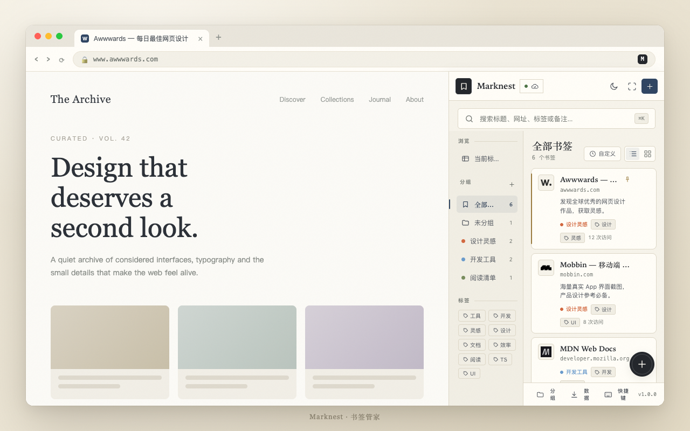
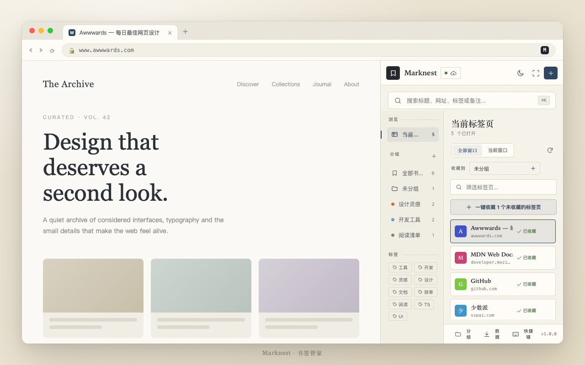
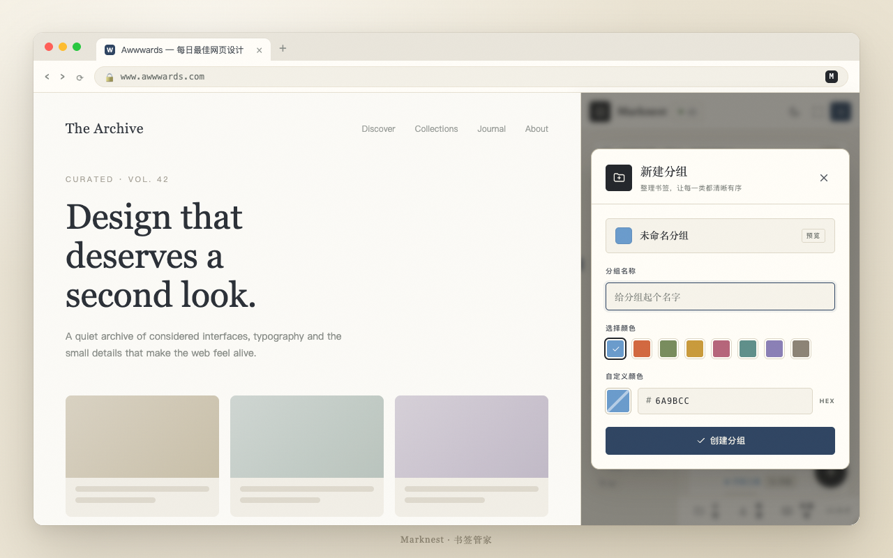
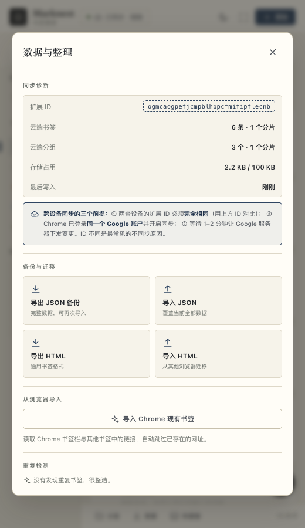
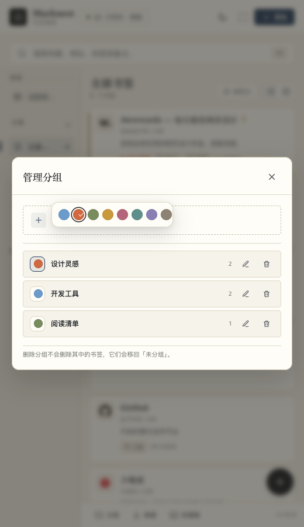

# Marknest · 书签管家

[](https://github.com/Monkey0803/marknest/releases/latest)
[](https://developer.chrome.com/docs/extensions/develop/migrate)

一个基于 **Chrome Manifest V3** 的书签管理**侧边栏**扩展。点击工具栏图标即在浏览器右侧展开侧边栏（高度与浏览器窗口一致、宽度可拖动），分组、标签、搜索、重复检测一应俱全，数据通过 `chrome.storage.sync` **跟随你的 Google 账户自动同步**到所有登录了同一账户的 Chrome 设备——无需后端、无需 OAuth 配置。



---

## 项目特色

> **一句话概括**：用「零后端同步 + 容量优化」解决跨设备痛点，用「无限层级 + 智能检索 + 回收站/撤销」构建完整整理闭环，同时保持零部署门槛与隐私友好。

和其他书签工具相比，Marknest 的差异化集中在以下六点：

1. **零后端、零配置的跨设备同步** — 数据写入 `chrome.storage.sync`，登录 Google 账户即自动上云，无需自建后端与 OAuth 配置；`manifest.json` 中写入固定 `key`，扩展 ID 恒为 `ogmcaogpefjcmpblhbpcfmifipflecnb`，保证任意设备、任意加载方式都落在同一数据分区，多端通过 `storage.onChanged` 实时更新。

2. **为同步容量而生的存储优化** — 「瘦身 + 分组压缩 + 增量写入」：favicon 不入库（按域名推导），书签按约 50 条一组压缩，**新增/编辑一条只写 1~2 组（约 2KB）而非全量重写**，规避 sync 写入频率限制。1000 条约 65 KB，容量天花板提升到约 1000~2000 条，超限前主动拦截并提示，不会静默丢数据。

3. **无限层级 + 智能检索的完整整理链** — 分组可无限嵌套、整组拖拽移动；支持 `tag:` `domain:` `group:` `before:` 等高级搜索语法、智能文件夹、Quick Switcher 与一键定位当前页面书签；**智能去重按 URL 指纹识别变体、逐组审阅并合并元数据**、标签语义去重、死链巡检覆盖清理全链路。

4. **每一步都可撤销、可恢复** — 20 步多级撤销栈 + 删除后 6 秒 toast 撤销，删除先进回收站；多设备冲突保留本地快照可一键「恢复我的版本」，同步失败弹条带重试，备份提醒与容量预警提前规避风险。

5. **真正适配侧边栏的交互与视觉** — 基于 Side Panel API 的真侧边栏（非弹层），宽度可拖拽、窄于 470px 自动收成抽屉；悬浮式卡片操作栏、完整且可自定义的快捷键、浅色/深色/跟随浏览器三态主题与克制的编辑风格视觉。

6. **零门槛部署、重隐私** — 下载解压即用，无需 Node.js，仓库自带构建好的 `dist/`；数据不经第三方服务器，提供 PIN 私密分组与只读 HTML 分享页。

> **适用边界**：受 `chrome.storage.sync` 官方上限约束，实际容量天花板约 1000~2000 条，不适合万级书签的重度用户；死链检测受浏览器跨域限制，结果仅为可达性参考。

---

## 同步原理

扩展把所有数据写入 `chrome.storage.sync`。Chrome 会在用户登录 Google 账户后，自动把该存储区的内容在设备间同步。因此：

- **只需在 Chrome 设置中登录 Google 账户并开启同步**，书签数据即自动上云。
- 在 A 设备新增/编辑书签，B 设备打开扩展会自动拉取更新（通过 `storage.onChanged` 实时监听）。
- 顶部同步徽标以颜色圆点 + 云图标表示状态（绿=已同步 / 橙=同步中 / 红=异常），鼠标悬停显示详情，点击可重新同步（宽窗口下还会显示「已同步 · 刚刚」文字）。

> **跨设备同步的必要条件**：`chrome.storage.sync` 按**扩展 ID** 隔离。两台设备必须安装**同一个扩展 ID**、登录**同一个 Google 账户**并开启同步，数据才会共享。本项目已在 `manifest.json` 中写入固定 `key`，因此从不同路径/系统加载时扩展 ID 恒定为 `ogmcaogpefjcmpblhbpcfmifipflecnb`。若你之前用无 key 的旧版本加载过，旧数据存在旧 ID 分区——请先导出 JSON，换成带 key 的新版后再导入（详见根目录《同步问题修复说明.md》）。可在「数据 → 同步诊断」核对扩展 ID、分片数与存储占用，自助排查不同步问题。

> **容量说明**：`chrome.storage.sync` 有单条 8KB、总量 100KB 的官方限制。Marknest v1.3 起采用**瘦身 + 分组压缩 + 增量写入**：favicon 字段不参与同步（读取端按域名经 Google 图标服务推导）；书签按 order 排序切成约 50 条一组的独立压缩组，**写入时只更新变化的组**——新增/编辑一条书签通常只写 1~2 组（约 2KB），而非全量重写（数十 KB），也更不容易触发 sync 的写入频率限制。实测 1000 条书签约占 65 KB，容量天花板提升到**约 1000~2000 条**；旧版本（v1 明文 / v2 整体压缩）数据自动迁移并清理。若数据超过 100KB 总量上限，新增书签会在写入前被拦截并明确提示，此时建议导出 JSON 备份后清理数据。

---

## 安装

### 方式一：下载即用（推荐，无需 Node.js）

1. 打开 [Releases](https://github.com/Monkey0803/marknest/releases/latest)，下载 **`marknest-v1.5.0.zip`**。
2. 解压，得到一个 `marknest-v1.5.0` 文件夹——**打开后应能直接看到 `manifest.json`**（不是它里面的 `assets` 子目录）。
3. Chrome 地址栏输入 `chrome://extensions`，打开右上角的「**开发者模式**」。
4. 点击「**加载已解压的扩展程序**」，选择第 2 步解压出的那个文件夹。
5. 浏览器工具栏出现 Marknest 图标（赤陶色书签），**点击图标即在右侧展开书签侧边栏**。侧边栏高度自动等于浏览器内容区高度，宽度可通过拖动左边缘调整（初始 400px）。

> Chrome 只能加载**文件夹**、不能直接加载 zip，所以必须先解压。个别解压工具会多套一层目录，请一路选到能看到 `manifest.json` 的那一层。

> **更新到新版本**：下载新包解压后覆盖原文件夹，回到 `chrome://extensions` 点一次该扩展的刷新图标即可。书签数据存放在 `chrome.storage.sync`，覆盖文件不会丢失，无需重新导入。

### 方式二：从源码构建

```bash
git clone https://github.com/Monkey0803/marknest.git
cd marknest
npm install
npm run build      # 产物输出到 dist/
```

随后在扩展页选择仓库里的 **`dist`** 文件夹。版本库中已附带最新构建的 `dist/`，克隆后不构建也能直接加载；改动源码后需重新执行 `npm run build`。

> **侧边栏说明**：本扩展使用 Chrome 的 Side Panel API，是真正的侧边栏而非弹出浮层。点击顶栏的放大图标可在独立标签页打开更宽的管理界面；在该界面点击放大图标可切回侧边栏。也可以在网页上右键「在大窗口打开 Marknest」。

---

## 功能

### 核心
- **书签增删改查**：添加、编辑、删除、在新标签页打开、**一键复制链接**。点「＋」或按 `⌘/Ctrl + N` 时，若当前有网页标签会自动**预填网址与标题**，回车即存。
- **网站图标**：每条书签显示网站真实 logo（favicon）。收藏浏览器标签页或右键收藏页面时自动保存站点图标；已有书签会依次尝试「站点 favicon.ico → Google 图标服务」推导，全部失败才回退首字母色块，无需手动维护。
- **读取当前标签页**：侧栏「当前标签页」列出浏览器中打开的所有标签页（可切换「全部窗口 / 当前窗口」），支持筛选；已收藏的自动标记。未收藏的每行点「＋」会弹出**分组选择菜单**——可选已有分组或现场新建分组后直接收藏；顶部「收藏到」可设定批量默认分组，一键批量导入时自动跳过已存在的网址避免重复。点击标签页可快速切换到它。
- **一键定位当前页面书签**：顶栏准星按钮（或 `⌘/Ctrl + ⇧ + L`、`⌘/Ctrl + K` 命令面板里的「定位当前页面在书签中的位置」）读取当前活动标签的网址，自动清除搜索与标签筛选、切到该书签所在分组，滚动并高亮命中卡片 5 秒；未收藏时提示并可一键打开收藏弹窗。「当前标签页」视图中，活动标签行也有准星按钮，收藏与定位同一页面只需两步。网址按协议、尾斜杠、大小写归一化比对，http/https 或末尾 `/` 差异不会漏匹配。
- **分组管理**：新建/重命名/改色/删除分组，双击名称可快速重命名。侧栏「分组」标题右侧是一个**带文字的胶囊按钮**（不再依赖悬浮提示）：平时显示「＋ 新建」创建顶层分组；当前正在浏览某个分组时变成强调色的「＋ 子分组」，直接建在它下面。
- **无限层级分组**：分组里可以再建分组（子分组）。侧栏按层级缩进展示、带折叠箭头，父分组计数自动包含所有后代的书签；点击父分组会同时展示整棵子树里的书签，标题下显示层级路径。
- **整组移动**：把侧栏里的分组直接拖到另一个分组上即可整组嵌套；拖到「分组」标题行则移回顶层。也可在「管理分组」面板点「移动」按钮选择目标（菜单里自动排除自身与其子分组，避免成环）。删除分组时子分组与书签会向上提升一级，不会丢数据。
- **统一新建分组对话框**：所有新建入口（侧栏快捷入口、收藏弹窗、标签页收藏菜单、分组管理面板）共用同一个精致对话框——顶部实时预览、填名称、选预设色块或用**自定义颜色**（取色器 + HEX 值，如 `#7B3FE4`），创建后自动选用/归入/切换。界面舒展，浅色深色主题一致。
- **收藏时指定/新建分组**：添加书签时可直接选择分组，或在分组下拉里选「＋ 新建分组…」现场创建并自动选用；从「当前标签页」收藏时可先设定「收藏到」分组（同样支持现场新建），单条收藏与一键批量导入都会归入该分组。
- **拖拽整理**：拖动书签调整顺序；拖到某个书签上归入该书签所在分组；直接拖到侧栏的任意分组上即可归入该分组（拖到「未分组」移出分组）。
- **移动到分组**：每条书签的操作栏有「移动到分组」按钮，弹出分组选择（含未分组与新建分组），选定后书签保持原位直接改归组，也可现场新建目标分组。
- **多选与批量操作**：点「多选」或按 `X`（`⌘/Ctrl + A` 全选）进入多选，可批量**移动到分组 / 加标签 / 删除**，批量操作同样支持撤销。
- **先做后撤的删除**：删除书签、分组、标签、批量删除都不再弹系统确认框，而是直接执行并在底部给出 6 秒「撤销」。书签删除先进入**回收站**（见进阶整理），可从回收站还原或彻底删除。
- **新窗口打开分组**：鼠标悬停在侧栏分组上，点右侧的小图标即可在一个新浏览器窗口中打开该分组下的所有标签（最多 100 个，含子分组）；内容区标题栏也新增了同功能的图标按钮，不必再回侧栏。「全部书签」「未分组」同样支持。
- **搜索**：按标题、网址、域名、备注、标签实时过滤，并支持**按分组名搜索**（含父级路径，如「设计灵感 配色方案」）。
- **云同步**：随 Google 账户自动同步 + 跨设备实时更新 + 状态指示（窄面板显示简化的「已同步」）；**同步失败会弹出带「重试」的提示条**，不再只靠徽章变色；多设备同时编辑时会保留本地快照，可在提示条里「恢复我的版本」。

### 增强
- **标签**：为书签添加多个标签，侧边栏点击标签快速筛选；标签可**重命名、合并、删除**（侧栏「标签」右侧的「管理」按钮）。添加书签时会**联想已有标签**（并列出 5 个常用标签一键添加），减少「设计 / Design」这类同义标签；侧栏标签超过 8 个自动折叠为「+N」。管理面板会**自动检测语义重复的标签**（仅大小写、全半角或空格写法不同，如「设计 / Design / design」），一键合并为使用最多的写法。
- **快捷视图**：侧栏「最近添加」「最近访问」两个视图，快速回看最近 50 条。「访问次数」统计的是**在 Marknest 内打开**的次数（浏览器地址栏直接访问不会计入），空状态会说明这一点。
- **置顶**：重要书签固定在顶部（手动排序模式下生效）。
- **排序切换**：自定义 / 最近更新 / 标题 / 访问次数。点排序按钮弹出**下拉菜单**（含每项说明与当前项勾选），不再靠点击循环猜测。
- **首次使用引导**：没有任何书签时，空状态直接给出「导入 Chrome 书签 / 收藏当前页面 / 手动添加」三条路径；导入完成后自动跳到「最近添加」，能看到东西落在哪里。
- **视图切换**：列表视图 / 网格视图。
- **自适应侧栏**：侧栏宽度可拖拽调节（双击分隔条复位）；**窄于 470px**（Chrome 侧边栏的常见宽度）时侧栏自动收成**抽屉**——顶栏左上角汉堡按钮唤出、点击导航或遮罩自动收起，内容区独占整宽，标题可完整显示（两行）、工具栏与底栏文字标签保留；仅在窄于 380px 时才收起文字标签，所有按钮文字强制单行不换行，不会出现竖排文字与横向溢出。
- **卡片操作栏**：置顶 / 移动 / 复制链接 / 编辑 / 删除 / 拖动整理收在卡片右下角的悬浮条里，**悬浮或键盘聚焦时才出现**，不占常驻宽度（窄面板里省下的 34px 全部还给标题）。
- **图标缓存**：记录每个域名实际加载成功的 favicon，图片懒加载，避免每次打开面板重复请求。
- **导入导出**：JSON **完整备份**（含回收站与私密分组，用于灾难恢复，导入即可原样还原）、通用 Netscape HTML 书签文件（仅导出当前可见书签，排除回收站软删项与未解锁的私密分组）；一键导入 Chrome 现有书签，**按文件夹层级生成嵌套分组**（同名同层复用，网址自动去重，书签栏/其他书签等根容器不建分组，非 http 链接跳过并计数）。

> **浏览器书签读取依赖 `bookmarks` 权限**（见 `manifest.json` 的 `permissions`）。若点「导入 Chrome 现有书签」提示缺少权限，请在 `chrome://extensions` 里对本扩展点一次「重新加载」；从商店/CRX 安装的旧版本需先确认新增权限。也可在 Chrome 书签管理器导出 HTML 后用「导入 HTML」迁移。
- **智能去重**：按 **URL 指纹**归组（忽略协议、www、尾斜杠、追踪参数、hash 与 query 顺序，因此带 `?utm_source=x` 与干净网址会被识别为同一条）。逐组展示每条的信息完整度评分与差异（备注/标签/访问数/分组/置顶），默认推荐信息最全的一条保留、允许改写；合并时把冗余项的标签取并集、备注与访问数并入保留项，冗余项软删进回收站，单组或全部一次提交、可撤销可还原。入口在「数据 → 智能去重」。
- **搜索命中高亮**：搜索结果中命中的关键词以柔和荧光笔效果标出（标题、域名、备注）。
- **快速切换面板**：`⌘/Ctrl + K` 唤出 Quick Switcher，一个输入框同时搜书签、分组与常用命令，`↑↓` 选择、`Enter` 执行。
- **多级撤销**：删除、移动、批量操作、改标签等改动都会记入撤销栈，`⌘/Ctrl + Z` 可连续回退最近 20 步；误撤后可用 `⌘/Ctrl + Shift + Z`（或 `⌘/Ctrl + Y`）重做。删除后底部 toast 的「撤销」与快捷键共用同一撤销栈，不会出现重复撤销（输入框内的文本撤销仍走原生行为）。
- **阅读清单**：把书签标记为「稍后阅读」，侧栏入口显示未读数量；点开链接后自动移出清单，卡片操作栏可随时加入/移出。
- **书签健康检查**：数据面板统计无标签/无备注数量，并可检测死链（受跨域限制，结果为可达性参考），支持逐条或一键删除失效书签。
- **分组模板**：内置「内容创作 / 学习计划 / 项目工作 / 日常生活」四套分组结构，一键套用（同名分组自动跳过）。
- **备份提醒**：从未导出或超过 30 天未导出备份时，数据面板会提醒导出 JSON。
- **容量预警**：数据面板显示同步容量进度条，超过 80% 时提示备份与清理。
- **快捷键**：`⌘/Ctrl + K` 快速切换面板、`/` 聚焦搜索、`⌘/Ctrl + N` 新建、`⌘/Ctrl + ⇧ + L` 定位当前页面书签、`↑/↓` 移动焦点、`Enter` 打开、`X` 多选、`⌘/Ctrl + A` 全选、`⌘/Ctrl + Z` 撤销、`Esc` 退出多选/清除筛选/关闭弹窗。
- **深浅主题**：浅色 / 深色 / **跟随浏览器**三态，默认跟随浏览器（即 Chrome 外观模式或系统深浅色，实时响应切换）。顶栏主题按钮按「浅色 → 深色 → 跟随浏览器」循环，图标分别为太阳 / 月亮 / 半圆；`⌘/Ctrl + K` 命令面板也有对应命令。
- **编辑风格视觉**：暖白纸张底色、衬线标题字体、克制的墨蓝点缀、细线分隔与留白排版；计数用等宽数字对齐，按钮与菜单带克制的缓动过渡。深色主题同样保持清晰层次与高对比度。
- **右键菜单**：在任意网页右键「收藏此页面到 Marknest」，或直接收藏选中的链接。
- **大窗口模式**：点击顶栏的放大图标，在新标签页打开完整管理界面。

### 进阶整理（v1.5）
- **回收站**：删除书签先进入回收站（侧栏「回收站」与底栏入口都有角标），可**批量或单条还原 / 彻底删除 / 清空**；彻底删除仍可撤销。回收站不参与搜索、HTML 导出与去重，但会保留在 JSON 完整备份中（便于原样恢复）。
- **智能文件夹**：把搜索条件保存为虚拟分组，像普通分组一样出现在侧栏。支持 `tag:` `domain:` `group:` `before:` `after:` `unread` `pinned` `untagged` 组合条件（侧栏「智能文件夹 → 管理」创建）。
- **高级搜索语法与历史**：搜索框支持 `tag:设计 domain:github.com group:工作 未读 pinned after:2026-01-01` 等组合过滤；按 `Enter` 记住搜索词，下次点搜索框下方的最近搜索即可复用。
- **自动打标签**：在「设置 → 自动标签」配置「域名 / 关键词 → 标签」规则，收藏时自动追加标签（内置导入、右键收藏、浏览器同步均生效）。
- **追踪参数清理**：收藏时自动移除 `utm_*`、`fbclid`、`gclid` 等追踪参数（保留其它 query 与 hash），让网址更干净、去重更准。可在「设置 → 常规」关闭。
- **浏览器书签增量同步**：在「设置 → 浏览器同步」开启后，浏览器里书签的新增 / 改名 / 移动 / 删除会把变更**增量合并**进 Marknest（按 browserId 识别同源，不重复），删除默认进回收站。首次仍可用「导入 Chrome 书签」全量迁移。
- **批量编辑**：多选后可批量**改备注 / 替换网址前缀 / 按规则重命名标题**（「编辑」按钮）。
- **分层存储**：「设置 → 分层存储」可把长期未访问的冷书签标记为归档，仍可在「全部书签」浏览（卡片显示「归档」标记），随时一键取回。归档书签同样计入 `chrome.storage.sync` 以保证跨设备一致（否则其它设备会看不到、并可能覆盖丢失），同时在 `chrome.storage.local`（约 10 MB）另存完整副本作兜底。
- **数据洞察**：底栏「洞察」展示书签总数、域名 / 标签分布、按月收藏趋势与最常访问 Top 10。
- **死链巡检提醒**：「设置 → 死链巡检」开启后后台定时提醒检测，发现死链在顶栏显示角标；点设置里的「立即检测并查看结果」会打开数据面板的健康区，自动跑检测并列出可逐条或一键删除的死链。
- **快捷键自定义**：「设置 → 快捷键」可重绑 `⌘/Ctrl + K`、新建、定位、搜索、撤销等常用快捷键，随时恢复默认；快捷键面板会显示当前绑定。
- **私密分组**：「设置 → 私密」设 PIN 后，在分组设置里把分组标记为私密；未解锁时其书签（含子分组）从所有视图隐藏，点击私密分组输入 PIN 即可在本次会话内查看。PIN 仅做轻量哈希，防误看而非安全加密。
- **只读分享页**：分组设置里的「分享页」把该分组（含子分组）导出为独立 HTML 文件，样式自适应深浅色，可直接发给他人打开。

---

## 界面一览

| 当前标签页 | 新建分组 |
| --- | --- |
|  |  |

| 同步诊断 | 分组配色 |
| --- | --- |
|  |  |

---

## 开发

```bash
npm install        # 安装依赖
npm run dev        # 本地开发（Vite）
npm run typecheck  # 类型检查
npm run build      # 构建到 dist/
```

构建产物在 `dist/`，包含 `manifest.json`、`index.html`（popup）、`options.html`（大窗口）、`background.js`（Service Worker）、`assets/` 与 `icons/`。

发布到 GitHub Releases 的压缩包内容与 `dist/` 完全一致，`manifest.json` 位于压缩包根层（解压后即可加载）：

```bash
npm run build
cd dist && zip -r ../marknest-v1.5.0.zip . -x '*.DS_Store' -x '__MACOSX/*'
gh release create v1.5.0 ../marknest-v1.5.0.zip --title "Marknest v1.5.0" --notes-file <说明文件>
```

`dev-preview/` 提供了用模拟数据渲染的预览页，可在本地起静态服务器后用普通浏览器查看界面效果（无需加载扩展）：

```bash
# 在项目根目录启动（预览页引用 ../dist 的资源）
python3 -m http.server 8899
# 书签主界面：http://localhost:8899/dev-preview/preview.html
# 当前标签页：http://localhost:8899/dev-preview/preview.html?view=tabs
# 深色版：http://localhost:8899/dev-preview/preview-dark.html
```

---

## 项目结构

```
bookmark-hub/
├── dist/                    # 可直接加载的扩展产物
├── public/
│   ├── manifest.json        # MV3 配置
│   ├── background.js        # Service Worker（右键菜单收藏）
│   └── icons/               # 扩展图标 16/32/48/128
├── src/
│   ├── types.ts             # 数据模型
│   ├── lib/
│   │   ├── storage.ts       # storage.sync 分片读写 + 变更监听
│   │   └── utils.ts         # URL、排序、去重、导入导出等工具
│   ├── store/
│   │   └── useBookmarkStore.ts  # React 状态 + 乐观更新 + 同步状态机
│   ├── components/          # UI 组件（含内联 SVG 图标，无第三方图标库）
│   ├── styles/global.css    # 设计系统（浅色/深色主题）
│   └── App.tsx              # 主界面
├── index.html               # popup 入口
├── options.html             # 大窗口入口
├── store-assets/            # 商店文案、隐私页与界面截图（README 引用 out/*.png）
├── dev-preview/             # 模拟数据预览页
└── README.md
```
